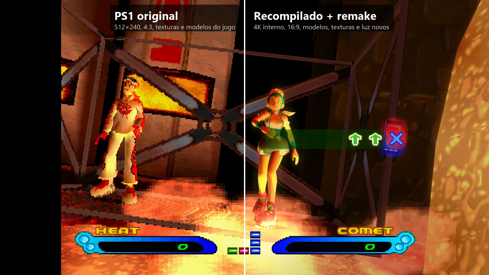
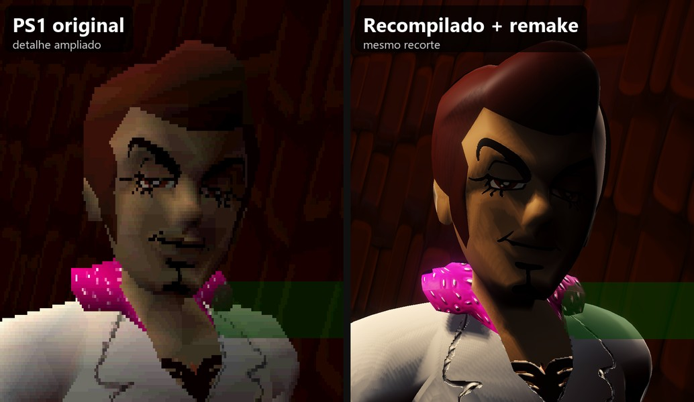
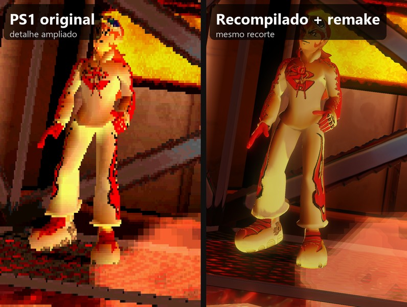
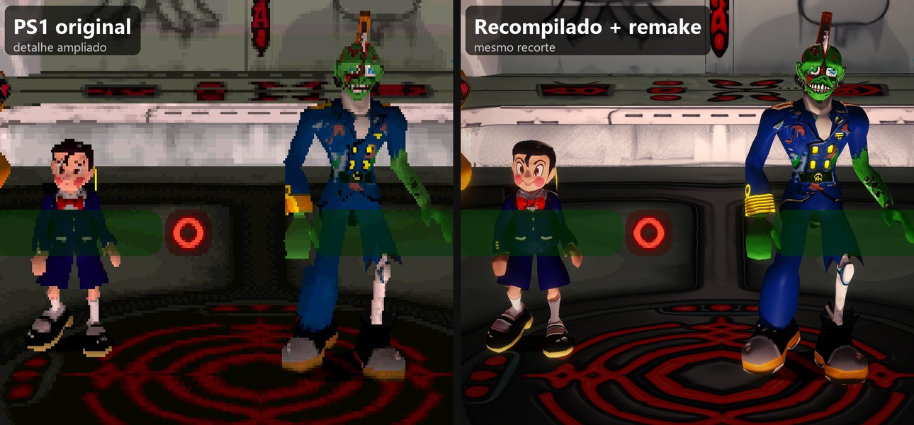
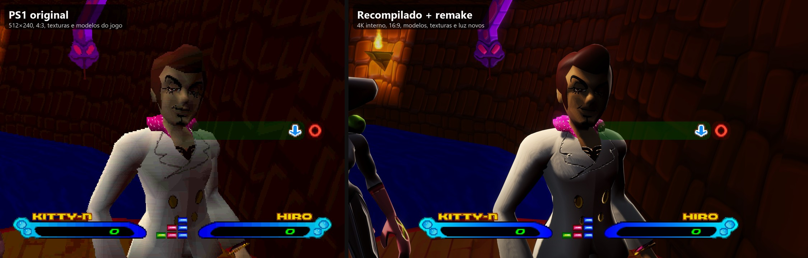
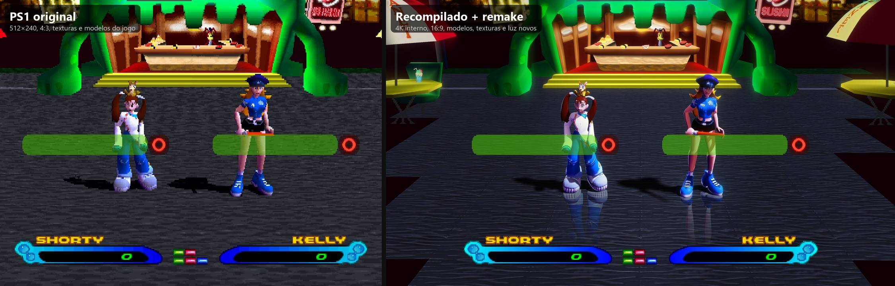
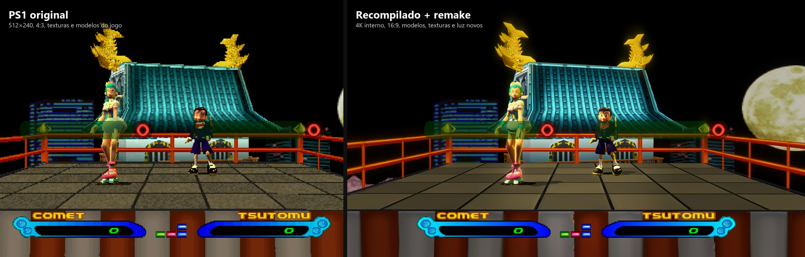
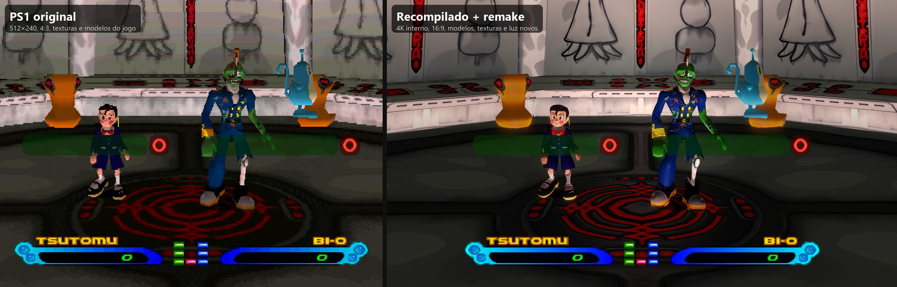
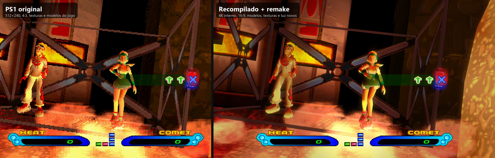

# Bust A Groove 2: Recompiled + Remake

**Bust A Groove 2** (PlayStation, 2000) rodando como programa nativo do Windows, sem emulador, com os gráficos
refeitos: personagens e palcos remodelados, resolução 4K, tela 16:9 e texturas em alta definição. A jogabilidade,
as animações, a câmera e a música são as do jogo original.



O repositório não contém o disco original (versão americana, SLUS-01159).

## O que muda

- **Personagens refeitos**: os 18 dançarinos, nos dois figurinos, com superfície suavizada, luz e sombra calculadas por
  pixel, mãos com dedos e as expressões do rosto do jogo.
- **Palcos refeitos**: a geometria dos 15 palcos com texturas em alta definição, relevo, brilho e reflexo no chão.
- **Imagem**: desenho interno em 4K reduzido para a tela, sem o tremor de polígonos do PS1, sem o pontilhado de cor.
- **Tela larga 16:9** de verdade: o jogo mostra mais cena nas laterais, sem esticar. Menus e vídeos ficam em 4:3.
- **Iluminação de cena**: brilho e cor que pulsam no tempo da música, sombra macia dos dançarinos no chão.
- **620 texturas em alta definição** (interface, menus, retratos, palcos), ampliadas 4x.
- **60 fps** estáveis, com a música no ritmo do console.

## Antes e depois

Todas as imagens mostram **o mesmo quadro da mesma partida** nas duas versões: o estado do jogo foi salvo na versão
melhorada e carregado na original. **Original** é o jogo como o PS1 desenha: 512 × 240 pixels, 4:3, as texturas e
modelos do disco, sem filtro, com o pontilhado de cor do console. **Melhorado** é a versão atual (`v2.0.0-remake`).
As faixas pretas da imagem do topo são o pedaço de cena que só existe no 16:9.

### Detalhe ampliado

| | |
|---|---|
|  |  |



### Lado a lado

À esquerda o original em 4:3, como numa TV; à direita a versão melhorada em 16:9.







## Como funciona

1. **Recompilação**: o [PSXRecomp](https://github.com/RetroPortingToolKit/psxrecomp) traduz o código do executável
   do jogo (e dos 56 módulos que ele carrega do disco) de instruções do processador do PS1 para C, que vira um `.exe`
   do Windows. O hardware do console (vídeo, som, CD) é reproduzido pelo runtime do framework, com vídeo em OpenGL.
2. **Remake por cima do jogo**: plugins em C se ligam a funções do próprio jogo. A cada quadro eles leem a pose de cada
   dançarino e a montagem do palco e desenham os modelos novos no lugar dos polígonos originais. O jogo continua
   decidindo tudo: passos, câmera, luzes, pontuação.
3. **Assets do remake**: gerados a partir dos dados do disco por scripts Python (`tools/remake/`): modelos refeitos,
   mapas de relevo, texturas ampliadas com Real-ESRGAN.

Detalhes técnicos em [docs/](docs): [plano e estado do remake](docs/remake-plano.md),
[técnica do remake](docs/remake-visual.md), [recompilação e build](docs/recomp.md), [formatos do disco](docs/formats.md).

## Jogar

Gere a pasta de jogo pelo [BUILD.md](BUILD.md) (último passo: montar uma release). Com a pasta pronta:

1. Ponha o `.cue` e o `.bin` do seu disco em `disc/`, dentro da pasta (o dump esperado está descrito em
   [disc/README.md](disc/README.md)).
2. Dois cliques em `Bust_A_Groove_2_Recompiled.exe`. `F11` alterna tela cheia e janela.

**Controles** (teclado, em `keybinds.ini`): setas = direcional, `X` = ✕, `S` = ○, `Z` = □, `A` = △, `Q`/`W` = L1/R1,
`E`/`R` = L2/R2, `Enter` = Start, `Shift` direito = Select. Gamepads (Xbox, DualShock e outros) funcionam sem
configurar. O cartão de memória fica em `saves/`.

**Ajustes** no `game.toml`, seção `[video]`: `internal_resolution` (`"4k"`, `"1440p"`, `"1080p"`, `"720p"`,
`"native"`), `aspect_ratio` (`"16:9"` ou `"4:3"`), `texture_filtering`, `dithering`. Tela cheia e tamanho da janela no
`settings.toml`.

### Requisitos do PC

| | Mínimo (estimado) | Recomendado (configuração padrão) | Máquina de teste |
|---|---|---|---|
| Sistema | Windows 10 64 bits | Windows 10 ou 11, 64 bits | Windows 10 Pro 22H2 |
| Processador | 4 núcleos a ~3,5 GHz: Core i5-6500, Ryzen 5 1500X | 6 núcleos: Core i5-8400, Ryzen 5 2600 ou melhor | Core i7-9700KF (8 núcleos, 3,6–4,9 GHz) |
| Placa de vídeo | OpenGL 3.3 com 4 GB: GeForce GTX 1050 Ti, Radeon RX 570, com `internal_resolution = "1080p"` | 6 GB ou mais: GeForce GTX 1660 Super, RTX 2060, Radeon RX 5600 XT | GeForce RTX 3070 Ti (8 GB) |
| Memória (RAM) | 8 GB | 16 GB | 32 GB |
| Disco | 4 GB livres (a pasta inteira, com o disco) | SSD | SSD NVMe |
| Tela | 1280 × 720 | 1920 × 1080 (16:9) | 1920 × 1080 |
| Controle | Teclado | Gamepad | Teclado e gamepad |

Na máquina de teste o jogo fica em 59,9 fps em todos os segundos de uma partida, sem falha de áudio. O processo usa
até 1,7 GB de memória de vídeo (no palco mais pesado) e 2,8–3,6 GB de RAM. O desenho interno em 4K é o que mais pesa
na placa de vídeo: com uma placa mais fraca, baixe `internal_resolution`. Os valores mínimos e recomendados são
estimativas a partir dessas medições: o jogo só foi testado na máquina da última coluna. Vídeo integrado (Intel UHD,
Radeon Vega) não foi testado.

## Versões

Cada versão é uma pasta `releases/vMAJOR.MINOR.PATCH-apelido/` montada localmente; o git guarda só os arquivos de texto
dela (configuração e `VERSION.txt`). Regras em [releases/README.md](releases/README.md).

| Versão | O que trouxe |
|---|---|
| `v2.0.0-remake` | **Atual.** Remake dos 18 personagens e dos 15 palcos, brilho e cor no tempo da música, sombra no chão, 620 texturas HD, música no ritmo do console. Pasta auto-suficiente: só o exe e o disco. |
| `v1.3.0-texturas-hd` | Texturas HD (472) ampliadas 4x com Real-ESRGAN. |
| `v1.2.0-widescreen` | Desenho interno em 4K, tela larga 16:9 com mais cena nas laterais. |
| `v1.1.0-1080p` | 1080p, geometria sem tremor (PGXP), tela cheia. |
| `v1.0.0-estavel` | Primeira versão recompilada, na resolução original. |

## Compilar

Passo a passo do zero em **[BUILD.md](BUILD.md)**: ferramentas e versões, o framework com os patches locais, a
extração do disco, o C gerado, o exe, os assets do remake, as texturas HD e a montagem da pasta de jogo. Com tudo
gerado, recompilar só o exe:

```
powershell -File recomp\build.ps1 -Step runtime
```

## Estrutura do repositório

| Pasta | O que tem |
|---|---|
| [`game/`](game) | O projeto do jogo: configuração (`game.toml`), plugins em C (`src/`: tela larga, remake dos personagens, remake dos palcos, núcleo de desenho em `src/remake/`), mods ligados por padrão |
| [`recomp/`](recomp) | Build: scripts, toolchain, os patches do PSXRecomp e o perfil dos módulos compilados antecipadamente |
| [`tools/remake/`](tools/remake) | Geração dos assets do remake e captura de dados com o jogo rodando |
| [`tools/tests/`](tools/tests) | Testes e medições com o jogo rodando: regressão, comparações, desempenho, áudio, memória |
| [`tools/extract/`](tools/extract) | Extração do disco (arquivos, texturas, vídeo, música) e disassembler |
| [`docs/`](docs) | Notas técnicas |
| [`disc/`](disc) | Onde fica o disco (fora do git); o `README.md` descreve o dump |
| [`releases/`](releases) | Versões montadas (só os textos no git) |
| [`archive/`](archive) | O que não se usa mais: a versão para navegador, testes com IA 3D, Ghidra |

## Android

Desde 2026-10-30 o Android é o **mesmo jogo recompilado num APK arm64** (runtime do PSXRecomp em OpenGL ES 3.2 +
plugins do remake): personagens e palcos refeitos, pós-efeito, texturas HD e 16:9 a 60 fps no Galaxy Tab S10 Ultra,
com controles Bluetooth e 2 jogadores local. Projeto em [`android/`](android/), scripts em `recomp/android/`, tudo
em [docs/android-apk.md](docs/android-apk.md). O APK leva o disco e o BIOS, então é de uso próprio: não vai para a
Google Play nem para este repositório (só o código). O caminho anterior, o [Polygonia](https://github.com/betinn/Polygonia)
(fork do DuckStation), continua documentado em [docs/android-fork.md](docs/android-fork.md) mas não é mais mexido.
